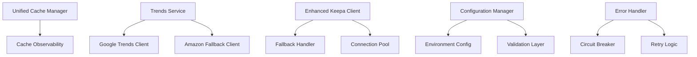

# Design Document

## Overview

This design document outlines the technical approach for implementing the codebase cleanup and optimization initiative for the PublishingStrategist project. The design focuses on consolidating redundant systems, improving code organization, and enhancing performance while maintaining backward compatibility and system reliability.

## Steering Document Alignment

### Technical Standards (tech.md)
The design follows established technical patterns:
- **Modular Architecture**: Each component has a single responsibility
- **Clean Interfaces**: Well-defined contracts between layers
- **Error Handling**: Consistent exception handling across all modules
- **Performance Optimization**: Connection pooling and intelligent caching
- **Testing Standards**: Comprehensive unit and integration test coverage

### Project Structure (structure.md)
The implementation will follow project organization conventions:
- **Logical Grouping**: Related functionality organized together
- **Clear Naming**: Descriptive file and function names
- **Separation of Concerns**: Data, business logic, and presentation layers separated
- **Configuration Management**: Centralized configuration with environment-specific overrides

## Code Reuse Analysis

### Existing Components to Leverage
- **Base Exception Classes**: Extend existing exception handling patterns from `src/kdp_strategist/exceptions.py`
- **Configuration System**: Build upon existing settings in `config/settings.py`
- **Logging Infrastructure**: Utilize existing logging configuration from `config/logging.conf`
- **Test Framework**: Extend current test patterns from `tests/` directory structure
- **API Router Patterns**: Follow existing FastAPI patterns from `api/routers/`

### Integration Points
- **FastAPI Application**: Integrate with existing API structure in `api/main.py`
- **Database Models**: Connect with existing models in `api/models/`
- **Middleware Stack**: Integrate with existing middleware in `api/middleware/`
- **Configuration Loading**: Extend current config loading mechanisms
- **Monitoring Systems**: Connect with existing monitoring in `monitoring/`

## Architecture

The cleanup and optimization follows a phased approach with modular design principles:

### Modular Design Principles
- **Single File Responsibility**: Each file handles one specific concern or domain
- **Component Isolation**: Create small, focused components rather than large monolithic files
- **Service Layer Separation**: Separate data access, business logic, and presentation layers
- **Utility Modularity**: Break utilities into focused, single-purpose modules
- **Interface Consistency**: Maintain consistent interfaces across similar components



## Components and Interfaces

### Component 1: Unified Cache Manager
- **Purpose:** Consolidate cache_manager.py and intelligent_cache.py into single system
- **Interfaces:** 
  - `get(key: str) -> Optional[Any]`
  - `set(key: str, value: Any, ttl: int = None) -> bool`
  - `invalidate(pattern: str) -> int`
  - `warm_cache(keys: List[str]) -> None`
- **Dependencies:** Redis/Memory backend, configuration system
- **Reuses:** Existing cache configuration patterns, Redis connection handling

### Component 2: Cache Observability
- **Purpose:** Merge cache_analytics.py and cache_monitor.py functionality
- **Interfaces:**
  - `get_metrics() -> CacheMetrics`
  - `track_operation(operation: str, key: str, hit: bool) -> None`
  - `generate_report(timeframe: str) -> CacheReport`
- **Dependencies:** Unified Cache Manager, metrics collection system
- **Reuses:** Existing monitoring infrastructure, logging patterns

### Component 3: Trends Service
- **Purpose:** Unified interface for trend data from multiple sources
- **Interfaces:**
  - `get_trends(keywords: List[str], timeframe: str) -> TrendData`
  - `get_related_queries(keyword: str) -> List[str]`
  - `health_check() -> ServiceStatus`
- **Dependencies:** Google Trends API, Amazon API fallback
- **Reuses:** Existing API client patterns, error handling utilities

### Component 4: Enhanced Keepa Client
- **Purpose:** Optimized Keepa client with integrated fallback logic
- **Interfaces:**
  - `get_product_data(asin: str) -> ProductData`
  - `get_price_history(asin: str, days: int) -> PriceHistory`
  - `batch_lookup(asins: List[str]) -> Dict[str, ProductData]`
- **Dependencies:** Keepa API, HTTP connection pool, circuit breaker
- **Reuses:** Existing HTTP client patterns, rate limiting middleware

### Component 5: Configuration Manager
- **Purpose:** Centralized configuration management with validation
- **Interfaces:**
  - `get_config(section: str, key: str) -> Any`
  - `validate_config() -> ValidationResult`
  - `reload_config() -> bool`
- **Dependencies:** Environment variables, config files
- **Reuses:** Existing settings.py patterns, environment loading

### Component 6: Error Handler
- **Purpose:** Consistent error handling across all modules
- **Interfaces:**
  - `handle_api_error(error: Exception, context: str) -> ErrorResponse`
  - `retry_with_backoff(func: Callable, max_retries: int) -> Any`
  - `circuit_breaker(service: str) -> Decorator`
- **Dependencies:** Logging system, monitoring
- **Reuses:** Existing exception classes, logging configuration

## Data Models

### CacheMetrics
```python
@dataclass
class CacheMetrics:
    hit_rate: float
    miss_rate: float
    total_operations: int
    average_response_time: float
    memory_usage: int
    eviction_count: int
```

### TrendData
```python
@dataclass
class TrendData:
    keyword: str
    timeframe: str
    data_points: List[TrendPoint]
    related_queries: List[str]
    source: str  # 'google' or 'amazon'
    confidence_score: float
```

### ProductData
```python
@dataclass
class ProductData:
    asin: str
    title: str
    current_price: float
    price_history: List[PricePoint]
    sales_rank: int
    category: str
    last_updated: datetime
```

### ServiceStatus
```python
@dataclass
class ServiceStatus:
    service_name: str
    is_healthy: bool
    response_time: float
    last_check: datetime
    error_message: Optional[str]
```

## Error Handling

### Error Scenarios
1. **Cache System Failures:**
   - **Handling:** Graceful degradation to direct data access
   - **User Impact:** Slightly slower response times, no data loss
   - **Recovery:** Automatic retry with exponential backoff

2. **API Rate Limiting:**
   - **Handling:** Circuit breaker pattern with intelligent backoff
   - **User Impact:** Temporary delays, fallback to cached data
   - **Recovery:** Automatic resume when rate limits reset

3. **External Service Outages:**
   - **Handling:** Fallback to alternative data sources
   - **User Impact:** Continued functionality with alternative data
   - **Recovery:** Health checks and automatic failover

4. **Configuration Errors:**
   - **Handling:** Validation on startup with clear error messages
   - **User Impact:** Application fails to start with descriptive errors
   - **Recovery:** Configuration validation and correction guidance

5. **Database Connection Issues:**
   - **Handling:** Connection pooling with retry logic
   - **User Impact:** Brief delays during reconnection
   - **Recovery:** Automatic reconnection with health monitoring

## Testing Strategy

### Unit Testing
- **Approach:** Test each component in isolation with mocked dependencies
- **Key Components to Test:**
  - Cache operations (get, set, invalidate)
  - API client methods with various response scenarios
  - Configuration validation logic
  - Error handling and retry mechanisms
  - Data model serialization/deserialization

### Integration Testing
- **Approach:** Test component interactions and external service integration
- **Key Flows to Test:**
  - Cache-through patterns with database fallback
  - API client failover between primary and fallback services
  - Configuration loading across different environments
  - End-to-end data flow from API to cache to response
  - Error propagation and recovery scenarios

### End-to-End Testing
- **Approach:** Test complete user scenarios with real or realistic data
- **User Scenarios to Test:**
  - Trend analysis workflow with cache hits and misses
  - Product data retrieval with Keepa API integration
  - System behavior during external service outages
  - Performance under load with concurrent requests
  - Configuration changes and system restart scenarios

## Implementation Phases

### Phase 1: Critical Redundancy Elimination (4-6 days)
- **Cache System Consolidation:** Merge overlapping cache implementations
- **Trends Client Simplification:** Consolidate multiple trends clients
- **Testing:** Unit tests for new unified components
- **Validation:** Ensure no functionality regression

### Phase 2: Medium Priority Optimizations (3-4 days)
- **Keepa Client Enhancement:** Integrate fallback logic
- **Test Organization:** Restructure test files and patterns
- **Configuration Consolidation:** Merge overlapping config files
- **Testing:** Integration tests for enhanced components

### Phase 3: Code Quality Improvements (2-3 days)
- **File Organization:** Remove unused files and improve structure
- **Error Handling:** Standardize error handling patterns
- **Documentation:** Update documentation and code comments
- **Testing:** End-to-end tests for complete workflows

### Phase 4: Performance Optimizations (3-5 days)
- **Connection Pooling:** Implement HTTP connection pooling
- **Cache Optimization:** Intelligent cache warming and invalidation
- **Database Optimization:** Query optimization and indexing
- **Testing:** Performance and load testing

## Migration Strategy

### Backward Compatibility
- **Interface Preservation:** Maintain existing public interfaces during transition
- **Feature Flags:** Use feature flags to enable gradual rollout
- **Deprecation Warnings:** Add warnings for deprecated functionality
- **Documentation:** Clear migration guides for any breaking changes

### Rollback Plan
- **Version Control:** Tag stable versions before major changes
- **Feature Toggles:** Ability to quickly disable new functionality
- **Database Migrations:** Reversible database schema changes
- **Monitoring:** Real-time monitoring during deployment

## Performance Considerations

### Optimization Targets
- **API Response Time:** Reduce by 30% through caching and connection pooling
- **Memory Usage:** Reduce by 25% through efficient data structures
- **Cache Hit Rate:** Improve to 90%+ through intelligent caching
- **Error Recovery:** Reduce recovery time by 50% through circuit breakers

### Monitoring and Metrics
- **Response Time Tracking:** Monitor API endpoint performance
- **Cache Performance:** Track hit rates, eviction rates, and memory usage
- **Error Rates:** Monitor error frequencies and recovery times
- **Resource Usage:** Track CPU, memory, and network utilization

## Security Considerations

### API Security
- **Rate Limiting:** Implement proper rate limiting for external APIs
- **API Key Management:** Secure storage and rotation of API keys
- **Input Validation:** Validate all external inputs and API responses
- **Error Information:** Prevent sensitive information leakage in error messages

### Data Protection
- **Cache Security:** Encrypt sensitive data in cache storage
- **Logging Security:** Avoid logging sensitive information
- **Configuration Security:** Secure storage of configuration secrets
- **Access Control:** Implement proper access controls for admin functions